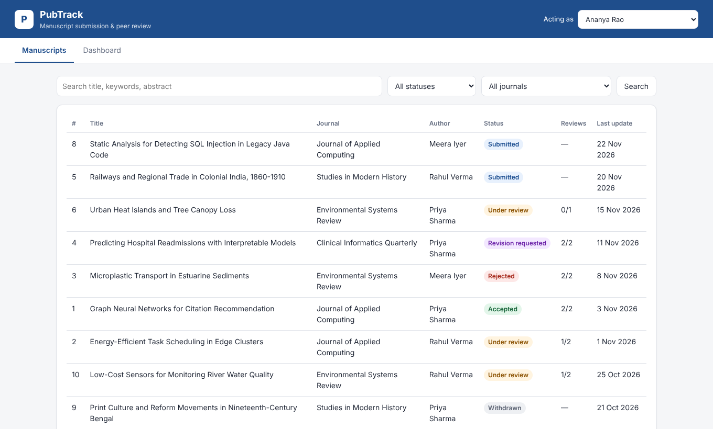
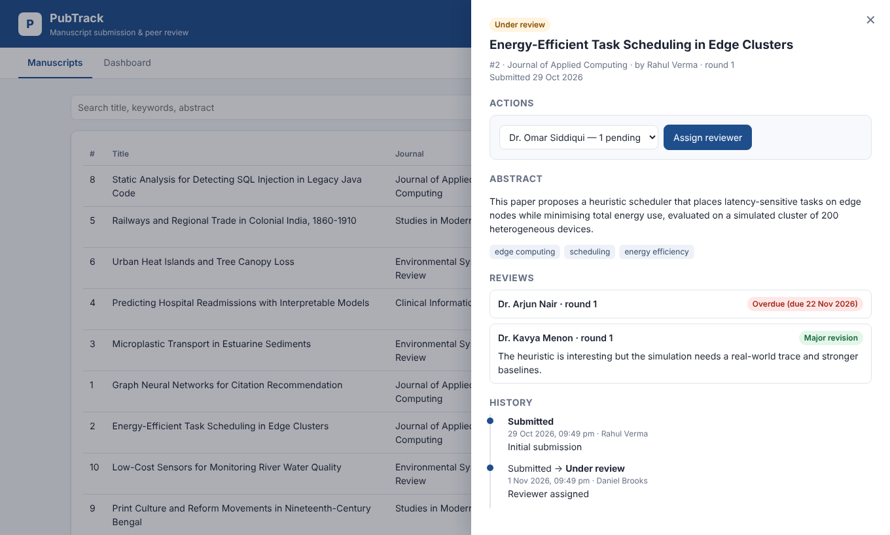
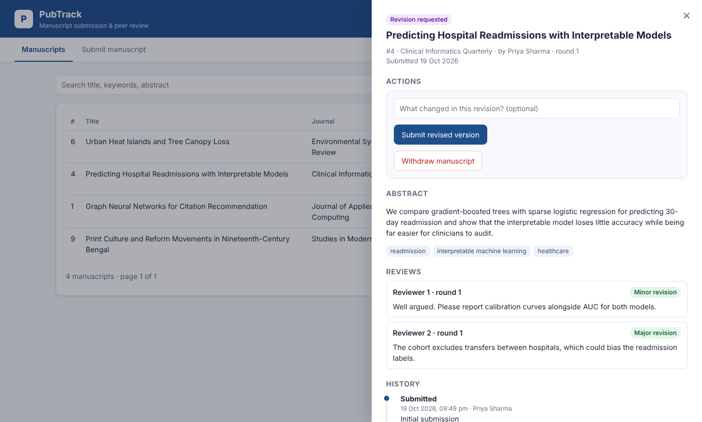
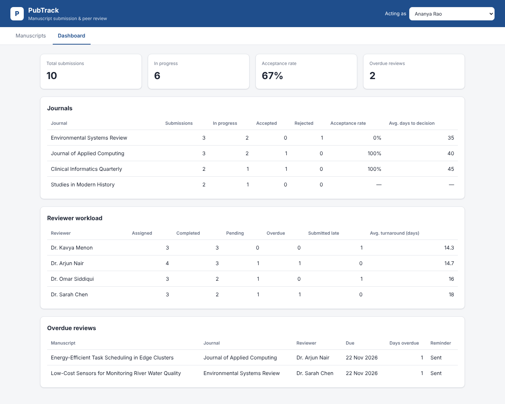
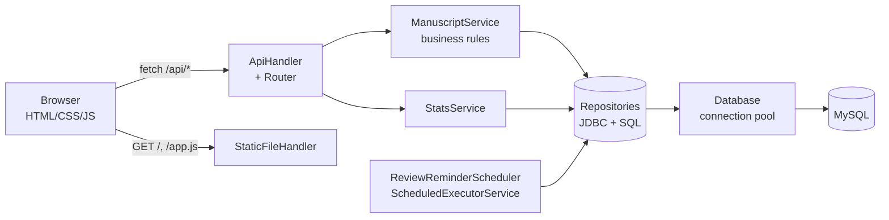
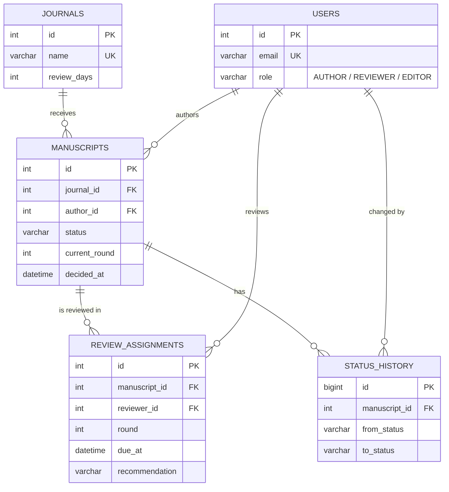
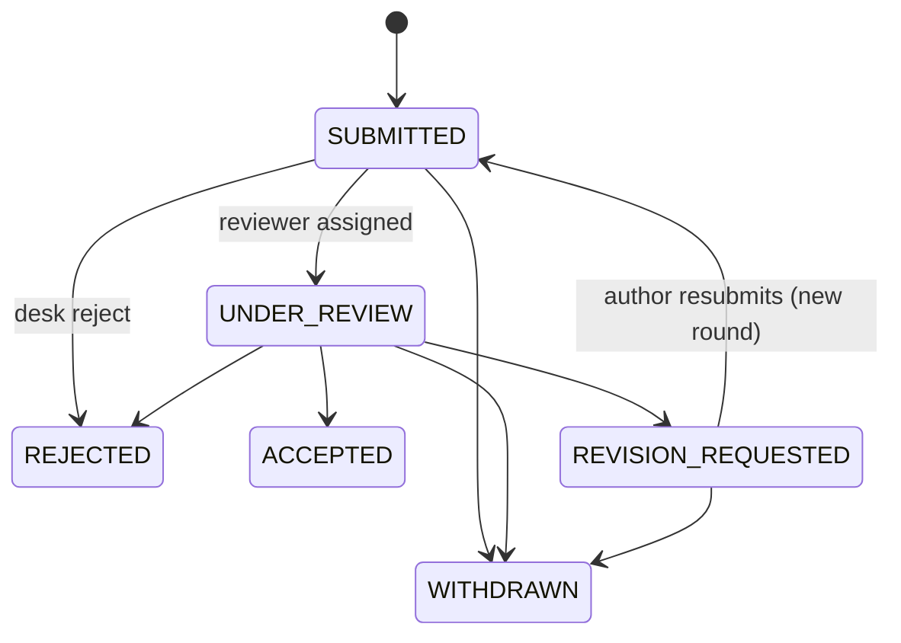

# PubTrack: Manuscript Submission & Peer-Review Tracker

A web app that manages how a research paper moves through a journal: **an author submits it → an editor assigns reviewers → reviewers send recommendations → the editor accepts, rejects or asks for a revision.**

It's built with **Core Java (no framework), JDBC and MySQL**, and the frontend is plain **HTML, CSS and JavaScript**. The HTTP server, routing, JSON output, connection pool and background scheduler are all written by hand on top of the JDK, so every part of the request path is visible in the code.



## Features

| Role | Can do |
|---|---|
| **Author** | Submit manuscripts, track status, read anonymised reviews after a decision, resubmit after a revision request, withdraw |
| **Editor** | See every manuscript, assign up to 3 reviewers per round (sorted by current workload), desk-reject, accept / reject / request revision, view the analytics dashboard |
| **Reviewer** | See invited manuscripts, submit a recommendation with comments, see pending and overdue assignments |

- **Workflow state machine.** Illegal moves (e.g. accepting an unreviewed paper) are blocked on the server.
- **Blind peer review.** Authors see "Reviewer 1", "Reviewer 2", never the reviewer's name, and only once a decision has been made.
- **Multiple review rounds.** A resubmission starts round 2, and round-1 reviews don't count towards the next decision.
- **Full audit trail.** Every status change records who made it, when, and why.
- **Full-text search** across title, keywords and abstract (MySQL `FULLTEXT`, boolean mode, prefix matching), plus status/journal filters and pagination.
- **Editor dashboard.** Acceptance rate and average days to decision per journal, reviewer workload and turnaround, and a list of overdue reviews.
- **Automatic reminders.** A background job finds overdue reviews every hour and sends each reviewer a single reminder (it's logged, so you can swap in SMTP later).
- **Safe under concurrent use.** Row locks plus a unique key mean that 10 simultaneous "assign reviewer" requests produce exactly one assignment.

| Editor view | Author view (blind review) |
|---|---|
|  |  |



## Tech stack

- **Backend:** Java 17, `com.sun.net.httpserver.HttpServer`, JDBC (`PreparedStatement`), `java.util.concurrent`
- **Database:** MySQL 8 (InnoDB, foreign keys, CHECK constraints, composite and FULLTEXT indexes, transactions)
- **Frontend:** HTML5, CSS3, vanilla JavaScript (`fetch`, DOM API)
- **Testing:** JUnit 5 (unit tests, plus integration tests against a real MySQL database)
- **Build:** Maven. The only runtime dependency is `mysql-connector-j`.

## Architecture



Layers: **web** (HTTP parsing, routing, JSON) → **service** (rules, permissions, transactions) → **repository** (SQL only) → **db** (pool, transactions).

## Database design



Full DDL: [`src/main/resources/db/schema.sql`](src/main/resources/db/schema.sql).

Points worth noting:
- `UNIQUE (manuscript_id, reviewer_id, round)` makes it impossible to invite the same reviewer twice in one round, even with concurrent requests.
- The `CHECK` constraints mean the database itself rejects invalid roles, statuses and recommendations.
- The composite index `(journal_id, status)` serves the filtered list, and `(reviewer_id, completed_at)` serves the reviewer workload queries.

### Manuscript lifecycle



## Running it locally

**You need:** JDK 17 or newer, Maven 3.8+ (IntelliJ IDEA bundles one), and MySQL 8.

**1. Create the database** (in MySQL Workbench or the `mysql` command line, as root):

```sql
CREATE DATABASE pubtrack;
CREATE USER 'pubtrack'@'localhost' IDENTIFIED BY 'pubtrack123';
GRANT ALL ON pubtrack.* TO 'pubtrack'@'localhost';
```

(If you have Docker, `docker compose up -d` does the same thing.)

**2. Run the app:**

```bash
mvn compile exec:java
```

Then open **http://localhost:8080**. The tables and demo data are created automatically on first start. Use the **"Acting as"** menu at the top right to switch between editor, author and reviewer.

To build a single runnable jar instead:

```bash
mvn package
java -jar target/pubtrack.jar
```

**Configuration** lives in `src/main/resources/application.properties`. You can override any value with an environment variable: `db.password` → `PUBTRACK_DB_PASSWORD`, `server.port` → `PUBTRACK_SERVER_PORT`.

## Tests

```bash
mvn test
```

This runs the unit tests (state machine, JSON writer, request parsing, routing). To also run the **integration tests**, which exercise the full workflow against MySQL, point them at an empty test database. It gets wiped before every test, so never use your real one:

```sql
CREATE DATABASE pubtrack_test;
GRANT ALL ON pubtrack_test.* TO 'pubtrack'@'localhost';
```

```bash
# macOS / Linux
PUBTRACK_TEST_DB_URL="jdbc:mysql://localhost:3306/pubtrack_test?allowPublicKeyRetrieval=true&useSSL=false" mvn test
# Windows (PowerShell)
$env:PUBTRACK_TEST_DB_URL="jdbc:mysql://localhost:3306/pubtrack_test?allowPublicKeyRetrieval=true&useSSL=false"; mvn test
```

There are 27 tests in total. They cover the happy path, permissions, blind review, revision rounds, withdrawal, duplicate prevention, reminders, full-text search and dashboard numbers.

## REST API

The API identifies the acting user with the `X-User-Id` header (a demo shortcut, see Limitations). POST bodies are form-encoded.

| Method | Path | Who | Purpose |
|---|---|---|---|
| GET | `/api/users`, `/api/journals` | anyone | Lookup lists |
| GET | `/api/manuscripts?q=&status=&journalId=&page=` | all (filtered by role) | Search / list |
| POST | `/api/manuscripts` | author | Submit (`journalId`, `title`, `abstract`, `keywords`) → **201** |
| GET | `/api/manuscripts/{id}` | permitted users | Details, visible reviews, history, allowed actions |
| POST | `/api/manuscripts/{id}/reviewers` | editor | Assign reviewer (`reviewerId`) |
| POST | `/api/manuscripts/{id}/decision` | editor | `decision` = ACCEPT / REVISE / REJECT, optional `note` |
| POST | `/api/manuscripts/{id}/resubmit` | owning author | Start next review round |
| POST | `/api/manuscripts/{id}/withdraw` | owning author | Withdraw and cancel pending reviews |
| GET | `/api/reviews/mine` | reviewer | My assignments |
| POST | `/api/reviews/{assignmentId}` | assigned reviewer | `recommendation`, `comments` |
| GET | `/api/stats` | editor | Dashboard data |

Errors come back as `{"error": "..."}` with a meaningful status: 400 for validation, 401 for no user, 403 for not allowed, 404 for not found, 409 for a conflict or invalid transition, 413 for a body that's too large.

## Design decisions

- **Why no Spring?** Writing the HTTP layer, routing, JSON output and connection pool by hand shows what a framework does under the hood. The service and repository layers are framework-agnostic, so moving to Spring Boot would mean replacing only the `web` and `db` packages.
- **SQL injection.** Every query uses `PreparedStatement` parameters. Even the dynamic search query only appends fixed SQL fragments and binds user input as values.
- **XSS.** The frontend inserts user text with `textContent`, never `innerHTML`, and the JSON writer escapes `<`.
- **Transactions and concurrency.** Each workflow action is one transaction that starts with `SELECT … FOR UPDATE` on the manuscript row. The status update also checks the expected old status (`UPDATE … WHERE status = ?`), which acts as an optimistic guard.
- **Single place for state changes.** `ManuscriptService.changeStatus` validates against the `ManuscriptStatus` enum and writes the audit row, so history can't drift from the actual state.
- **The server decides what you can do.** The detail endpoint returns an `actions` list, and the UI only renders buttons for those actions. The rules live in one place.
- **Robust scheduling.** A task scheduled with `ScheduledExecutorService.scheduleAtFixedRate` stops for good if it ever throws, so the reminder job catches and logs its own failures.

## Project structure

```
src/main/java/com/pubtrack/
├── App.java                 # wiring + server start-up / graceful shutdown
├── config/AppConfig.java    # properties + environment overrides
├── db/                      # connection pool, transactions, schema loader, JDBC helpers
├── model/                   # records and enums (state machine lives in ManuscriptStatus)
├── repository/              # all SQL
├── service/                 # business rules, permissions, reminder scheduler
├── exception/               # typed exceptions → HTTP status codes
└── web/                     # router, request parsing, JSON writer, handlers
src/main/resources/
├── db/schema.sql, db/seed.sql
└── static/                  # index.html, style.css, app.js
src/test/java/...            # JUnit 5 unit + integration tests
```

## Limitations and next steps

- Authentication is a header-based demo. Next step: login with BCrypt-hashed passwords and a session cookie or JWT.
- Manuscript files (PDF upload and versioning) aren't stored yet.
- Reminder emails are logged rather than sent (JavaMail/SMTP).
- Possible migration to Spring Boot with HikariCP and Flyway.
